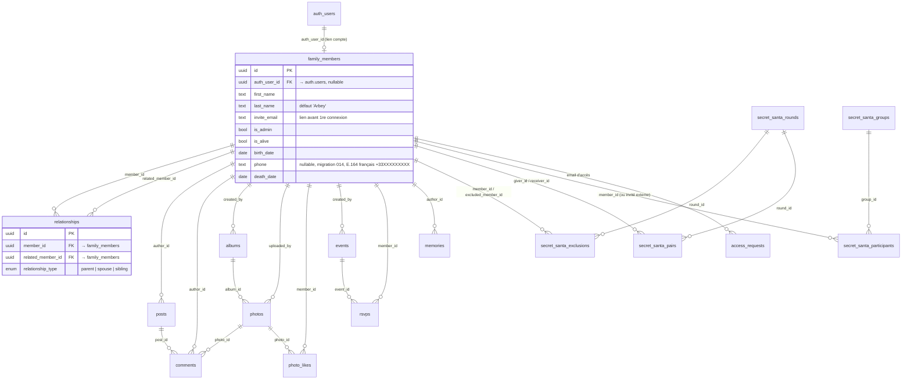
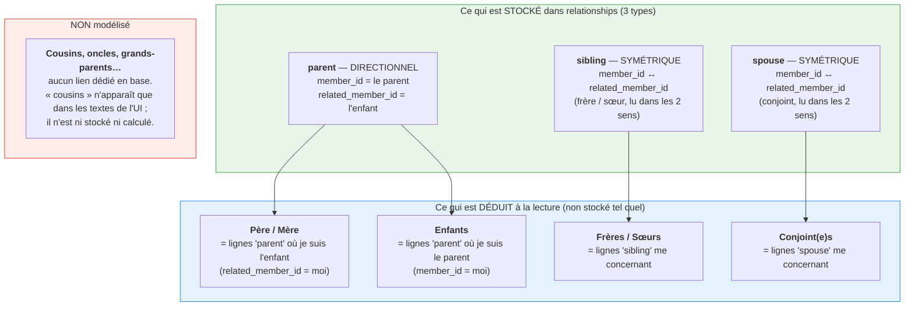

# 🌳 FamilyHub – Famille Arbey

Plateforme privée pour centraliser les souvenirs, l'arbre généalogique et la vie de la Famille Arbey.

## Stack

| Couche    | Technologie                    |
|-----------|--------------------------------|
| Frontend  | React + Vite + TypeScript + TailwindCSS + Zustand |
| Backend   | Node.js + Express (clean architecture) |
| Database  | Supabase (PostgreSQL + Storage) |

## Arbre généalogique

Vue unique, codée maison (React + SVG, aucune librairie de rendu d'arbre) : cartes photo, couples côte à côte, enfants centrés, connecteurs orthogonaux arrondis, pan/zoom (glisser, molette, pincement), recherche et choix de la racine (mamie par défaut). Données : `GET /members` + `GET /relationships`. Code dans `frontend/src/components/tree/` (`treeModel`, `treeLayout`, `TreeCanvas`, `TreeNodeCard`) et `frontend/src/pages/TreePage.tsx`.

## Ajouter un membre à ses contacts

Sur le profil d'un autre membre vivant, le bouton « Ajouter aux contacts » télécharge/ouvre une vCard 3.0 (nom, téléphone, email du compte ou d'invitation, anniversaire, photo, catégorie « Famille Arbey », lien du profil). iOS propose « Créer un contact » / « Ajouter à un contact existant », Android l'importe dans Google Contacts, desktop télécharge le `.vcf`. Le navigateur ne pouvant pas envoyer le header `Authorization` lors d'une navigation, le front demande d'abord un lien signé HMAC-SHA256 valable 2 minutes (clé dérivée de la clé service-role, aucune variable d'environnement supplémentaire).

## Structure

```
famillearbey/
├── docs/ARCHITECTURE.md       # Architecture détaillée
├── supabase/migrations/       # Schéma SQL versionné
├── backend/                   # API REST
└── frontend/                  # SPA React
```

## Modèle de données

### Schéma de la base (tables & relations)

Toutes les tables métier pointent vers `family_members` (le membre est l'entité
centrale). `auth.users` est géré par Supabase Auth (GoTrue) ; un membre y est relié
via `auth_user_id`.



> `relationships` est la seule table qui relie des membres **entre eux** : c'est elle
> qui porte tout l'arbre généalogique (voir ci-dessous). Les autres tables ne font que
> rattacher du contenu (posts, photos, événements…) à un membre.

### Comment sont enregistrés les liens de parenté

Point important : la base ne stocke **que 3 types de liens** (enum `relationship_type`) :
`parent`, `spouse`, `sibling`. Tous les autres liens (père, mère, enfant, grand-parent,
cousin…) sont soit **une lecture directionnelle** de ces 3 types, soit **non stockés du
tout** et déduits (ou pas) à l'affichage.

Chaque ligne de `relationships` a deux colonnes : `member_id` et `related_member_id`.
Le sens de lecture dépend du type :



**Détails de la dérivation** (implémentée côté backend, `familyMemberService` /
`relationshipService`) :

| Lien affiché      | Comment il est obtenu                                                                 |
|-------------------|----------------------------------------------------------------------------------------|
| **Père / Mère**   | lignes `parent` où `related_member_id = moi` → `member_id` est un parent               |
| **Enfants**       | lignes `parent` où `member_id = moi` → `related_member_id` est un enfant                |
| **Frères / Sœurs**| lignes `sibling` où je suis l'un des deux membres (symétrique)                          |
| **Conjoint(e)s**  | lignes `spouse` où je suis l'un des deux membres (symétrique)                           |
| **Cousins**       | ❌ non stocké, non calculé — terme purement éditorial dans l'interface                  |

> ⚠️ **Il n'y a pas de notion de genre** dans `family_members` : « père » et « mère »
> ne sont pas distingués en base, ce sont tous deux des liens `parent`. L'UI affiche
> donc un groupe « Parents » générique, pas « Père » / « Mère » séparément.
>
> L'arbre complet (`GET /api/v1/relationships/tree`) est reconstruit en mémoire à partir
> de ces lignes : on part des membres sans parent (les racines), puis on descend via les
> liens `parent`, en rattachant les `spouse` à chaque nœud.

## Démarrage rapide

### 1. Supabase

1. Créer un projet sur [supabase.com](https://supabase.com)
2. Exécuter `supabase/migrations/001_initial_schema.sql` dans le SQL Editor
3. Créer un bucket Storage nommé `albums` (public)
4. Récupérer l'URL du projet et la **service role key**

### 2. Backend

```bash
cd backend
cp .env.example .env
# Remplir SUPABASE_URL et SUPABASE_SERVICE_ROLE_KEY
npm install
npm run dev
```

API disponible sur `http://localhost:3001`

### 3. Frontend

```bash
cd frontend
cp .env.example .env
npm install
npm run dev
```

App disponible sur `http://localhost:5173`

## API (MVP)

| Méthode | Endpoint                        | Description              |
|---------|---------------------------------|--------------------------|
| GET     | `/api/v1/health`                | Santé de l'API           |
| GET     | `/api/v1/members`               | Liste des membres        |
| POST    | `/api/v1/members/:id/vcard-link`| Lien signé (2 min) vers la vCard d'un membre (connecté) -> `{ data: { url } }`, `url` relatif à `/api/v1` |
| GET     | `/api/v1/members/:id/vcard?exp=&sig=` | vCard 3.0 (`text/vcard`) du membre, publique mais protégée par la signature HMAC (403 si invalide/expirée, 404 si membre inconnu) |
| GET     | `/api/v1/relationships/tree`    | Arbre généalogique       |
| GET     | `/api/v1/albums`                | Liste des albums         |
| POST    | `/api/v1/albums`                | Créer un album           |
| GET     | `/api/v1/photos/album/:id`      | Photos d'un album        |
| POST    | `/api/v1/photos/album/:id`      | Upload photo (multipart) |

### Secret Santa : listes de souhaits

Migration : `supabase/migrations/015_secret_santa_wishlist.sql`. Les routes `/secret-santa/:id/...` exigent d'être connecté ; les équivalents `/secret-santa/invite/:token/...` servent les invités externes (lien personnel).

| Méthode | Endpoint (préfixe `/api/v1/secret-santa/:id`) | Description |
|---------|-----------------------------------------------|-------------|
| GET / POST | `/wishlist` | Ma liste / ajouter une idée (max 20) |
| PATCH / DELETE | `/wishlist/:itemId` | Modifier / retirer une de mes idées |
| GET | `/receiver-wishlist` | Liste de mon tiré (après tirage) + `picked` (mes cases) |
| PUT / DELETE | `/receiver-wishlist/:itemId/pick` | Cocher / décocher « Je prends ça » |

Confidentialité : le tiré ne voit jamais les cases cochées (table `secret_santa_wishlist_picks` séparée) ; le serveur retrouve le tiré via la paire du tireur, aucun identifiant de pair n'est exposé. `url` et `image_url` : `https://` uniquement. L'aperçu de lien est récupéré par le navigateur via Microlink (`https://api.microlink.io`, quota gratuit limité, l'URL collée lui est envoyée) puis copié dans l'idée ; si l'aperçu échoue, saisie manuelle.
### Groupes WhatsApp

Annuaire des groupes WhatsApp de la famille (remplace la Messagerie). Toutes les routes exigent d'être connecté. Migration : `supabase/migrations/016_whatsapp_groups.sql` (la suppression de l'ancienne messagerie est dans `017_remove_messaging.sql`, à appliquer séparément).

| Méthode | Route                                          | Description                                              |
|---------|------------------------------------------------|----------------------------------------------------------|
| GET     | `/api/v1/whatsapp-groups`                      | Groupes visibles (le lien n'est jamais renvoyé sans accès) |
| POST    | `/api/v1/whatsapp-groups`                      | Créer un groupe (tout utilisateur connecté)              |
| PATCH   | `/api/v1/whatsapp-groups/:id`                  | Modifier la fiche, dont le mode d'accès (tout membre ayant accès, ou admin ; épingle : créateur/admin) |
| DELETE  | `/api/v1/whatsapp-groups/:id`                  | Supprimer (créateur ou admin)                            |
| POST    | `/api/v1/whatsapp-groups/:id/image`            | Image du groupe (multipart, bucket `albums`, dossier `whatsapp-groups/`) |
| POST    | `/api/v1/whatsapp-groups/:id/access`           | Ajouter des personnes à l'accès (tout membre ayant accès, ou admin) |
| DELETE  | `/api/v1/whatsapp-groups/:id/access/:memberId` | Retirer une personne (tout membre ayant accès, ou admin ; le créateur garde toujours accès)               |
| PUT     | `/api/v1/whatsapp-groups/:id/joined`           | « J'y suis déjà » (`{ joined: boolean }`)                |
| POST    | `/api/v1/whatsapp-groups/:id/report-link`      | Signaler un lien cassé au créateur                       |

Accès : « Toute la famille » par défaut, ou « Accès limité » à une liste de personnes (une tribu ajoutée copie ses membres au moment de l'ajout). Un groupe sans accès est invisible (404), sauf pour les admins qui voient et modifient tous les groupes. Les notifications push de l'ancienne messagerie sont supprimées (plus de variables `VAPID_*`).
## PWA

L'app est installable (`frontend/public/manifest.json`, service worker `src/sw.ts`). Sur mobile/tablette uniquement (détection tactile `pointer: coarse` / userAgent / iPadOS, jamais sur ordinateur), pour un utilisateur connecté qui n'utilise pas la PWA installée, la modale `InstallPromptModal` (montée dans `Layout`) propose l'installation à chaque chargement ; sa fermeture ne vaut que pour la session. iOS : instructions manuelles en étapes numérotées avec illustrations SVG (Partager, puis « Sur l'écran d'accueil »), pas d'API d'installation. Android/Chrome/Edge : le manifest déclare `description` et `screenshots` (`frontend/public/screenshots/`, 4 captures `*-narrow.png` 390x844 et 2 `*-wide.png` 1280x800) pour l'interface d'installation enrichie ; ces PNG ne sont pas précachés par le service worker.

## Roadmap

Voir [ROADMAP.md](ROADMAP.md) et [CHANGELOG.md](CHANGELOG.md).

# famillearbey
