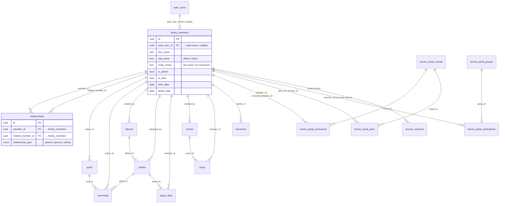
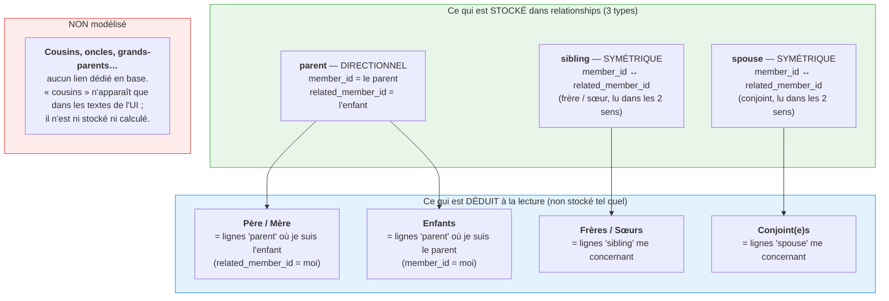

# 🌳 FamilyHub – Famille Arbey

Plateforme privée pour centraliser les souvenirs, l'arbre généalogique et la vie de la Famille Arbey.

## Stack

| Couche    | Technologie                    |
|-----------|--------------------------------|
| Frontend  | React + Vite + TypeScript + TailwindCSS + Zustand |
| Backend   | Node.js + Express (clean architecture) |
| Database  | Supabase (PostgreSQL + Storage) |

## Structure

```
famillearbey/
├── docs/ARCHITECTURE.md       # Architecture détaillée
├── supabase/migrations/       # Schéma SQL versionné
├── backend/                   # API REST
└── frontend/                  # SPA React
```

## Modèle de données

### Schéma de la base (tables & relations)

Toutes les tables métier pointent vers `family_members` (le membre est l'entité
centrale). `auth.users` est géré par Supabase Auth (GoTrue) ; un membre y est relié
via `auth_user_id`.



> `relationships` est la seule table qui relie des membres **entre eux** : c'est elle
> qui porte tout l'arbre généalogique (voir ci-dessous). Les autres tables ne font que
> rattacher du contenu (posts, photos, événements…) à un membre.

### Comment sont enregistrés les liens de parenté

Point important : la base ne stocke **que 3 types de liens** (enum `relationship_type`) :
`parent`, `spouse`, `sibling`. Tous les autres liens (père, mère, enfant, grand-parent,
cousin…) sont soit **une lecture directionnelle** de ces 3 types, soit **non stockés du
tout** et déduits (ou pas) à l'affichage.

Chaque ligne de `relationships` a deux colonnes : `member_id` et `related_member_id`.
Le sens de lecture dépend du type :



**Détails de la dérivation** (implémentée côté backend, `familyMemberService` /
`relationshipService`) :

| Lien affiché      | Comment il est obtenu                                                                 |
|-------------------|----------------------------------------------------------------------------------------|
| **Père / Mère**   | lignes `parent` où `related_member_id = moi` → `member_id` est un parent               |
| **Enfants**       | lignes `parent` où `member_id = moi` → `related_member_id` est un enfant                |
| **Frères / Sœurs**| lignes `sibling` où je suis l'un des deux membres (symétrique)                          |
| **Conjoint(e)s**  | lignes `spouse` où je suis l'un des deux membres (symétrique)                           |
| **Cousins**       | ❌ non stocké, non calculé — terme purement éditorial dans l'interface                  |

> ⚠️ **Il n'y a pas de notion de genre** dans `family_members` : « père » et « mère »
> ne sont pas distingués en base, ce sont tous deux des liens `parent`. L'UI affiche
> donc un groupe « Parents » générique, pas « Père » / « Mère » séparément.
>
> L'arbre complet (`GET /api/v1/relationships/tree`) est reconstruit en mémoire à partir
> de ces lignes : on part des membres sans parent (les racines), puis on descend via les
> liens `parent`, en rattachant les `spouse` à chaque nœud.

## Démarrage rapide

### 1. Supabase

1. Créer un projet sur [supabase.com](https://supabase.com)
2. Exécuter `supabase/migrations/001_initial_schema.sql` dans le SQL Editor
3. Créer un bucket Storage nommé `albums` (public)
4. Récupérer l'URL du projet et la **service role key**

### 2. Backend

```bash
cd backend
cp .env.example .env
# Remplir SUPABASE_URL et SUPABASE_SERVICE_ROLE_KEY
npm install
npm run dev
```

API disponible sur `http://localhost:3001`

### 3. Frontend

```bash
cd frontend
cp .env.example .env
npm install
npm run dev
```

App disponible sur `http://localhost:5173`

## API (MVP)

| Méthode | Endpoint                        | Description              |
|---------|---------------------------------|--------------------------|
| GET     | `/api/v1/health`                | Santé de l'API           |
| GET     | `/api/v1/members`               | Liste des membres        |
| GET     | `/api/v1/relationships/tree`    | Arbre généalogique       |
| GET     | `/api/v1/albums`                | Liste des albums         |
| POST    | `/api/v1/albums`                | Créer un album           |
| GET     | `/api/v1/photos/album/:id`      | Photos d'un album        |
| POST    | `/api/v1/photos/album/:id`      | Upload photo (multipart) |

### Messagerie et notifications push (branche `feature/chat`)

Toutes les routes exigent d'être connecté. Migration : `supabase/migrations/011_messaging.sql`.

| Méthode | Endpoint                                  | Description                                  |
|---------|-------------------------------------------|----------------------------------------------|
| GET     | `/api/v1/conversations`                   | Mes conversations                            |
| POST    | `/api/v1/conversations`                   | Créer une conversation (admin)               |
| GET     | `/api/v1/conversations/:id/messages`      | Messages                                     |
| POST    | `/api/v1/conversations/:id/messages`      | Envoyer un message                           |
| PUT     | `/api/v1/conversations/:id/members/:mid`  | Ajouter un membre                            |
| DELETE  | `/api/v1/conversations/:id/members/:mid`  | Retirer un membre                            |
| PATCH   | `/api/v1/conversations/:id/muted`         | Couper / réactiver les notifications         |
| POST    | `/api/v1/conversations/:id/read`          | Marquer comme lu                             |
| GET     | `/api/v1/push/public-key`                 | Clé publique VAPID                           |
| POST    | `/api/v1/push/subscribe`                  | Abonner l'appareil aux notifications push    |
| POST    | `/api/v1/push/unsubscribe`                | Désabonner l'appareil                        |

Variables d'environnement backend : `VAPID_PUBLIC_KEY`, `VAPID_PRIVATE_KEY`, `VAPID_SUBJECT`.

## Roadmap

Voir [ROADMAP.md](ROADMAP.md) et [CHANGELOG.md](CHANGELOG.md).

# famillearbey
